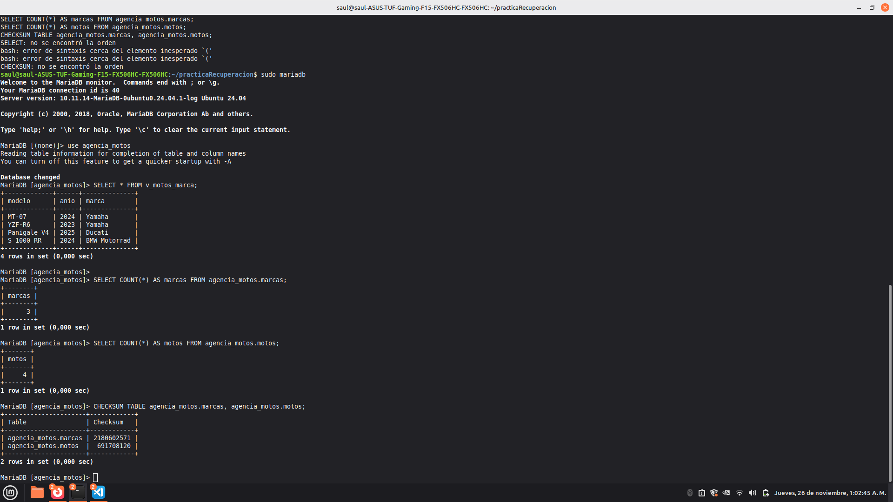
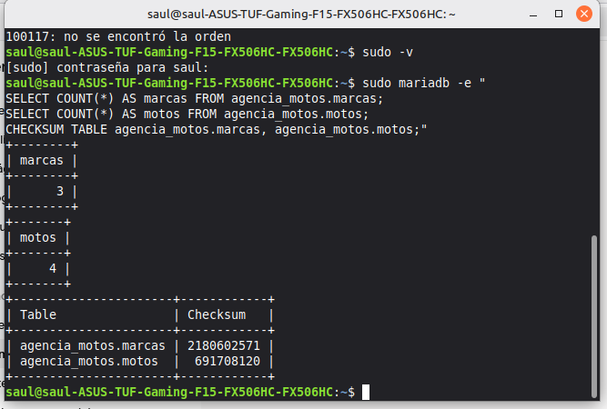
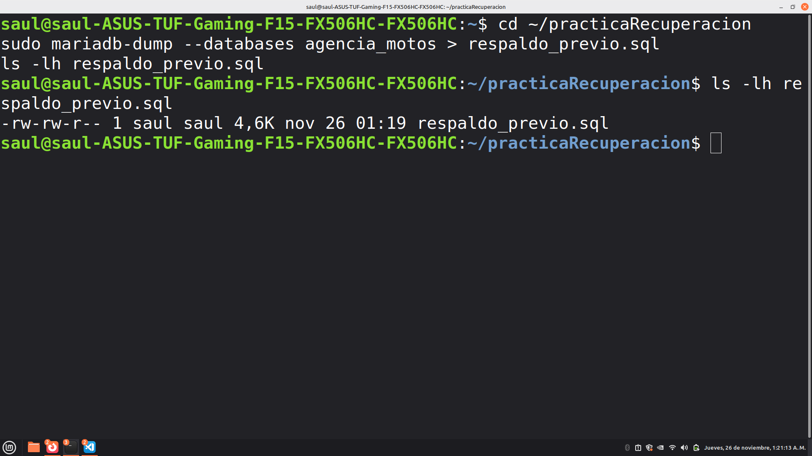
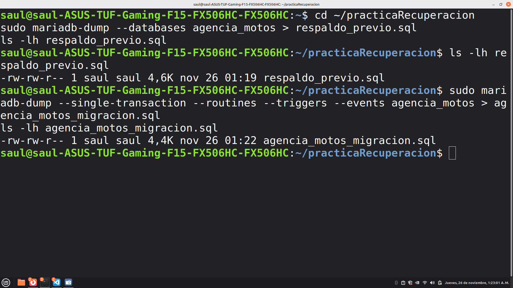
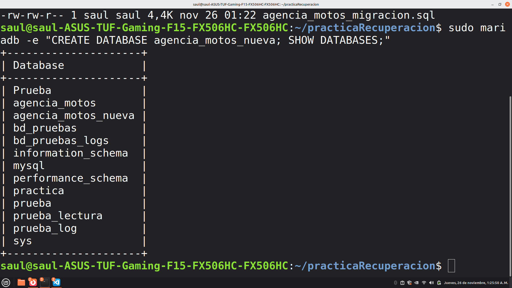
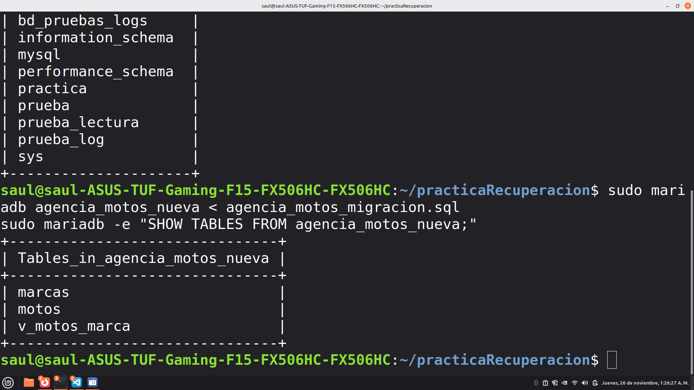
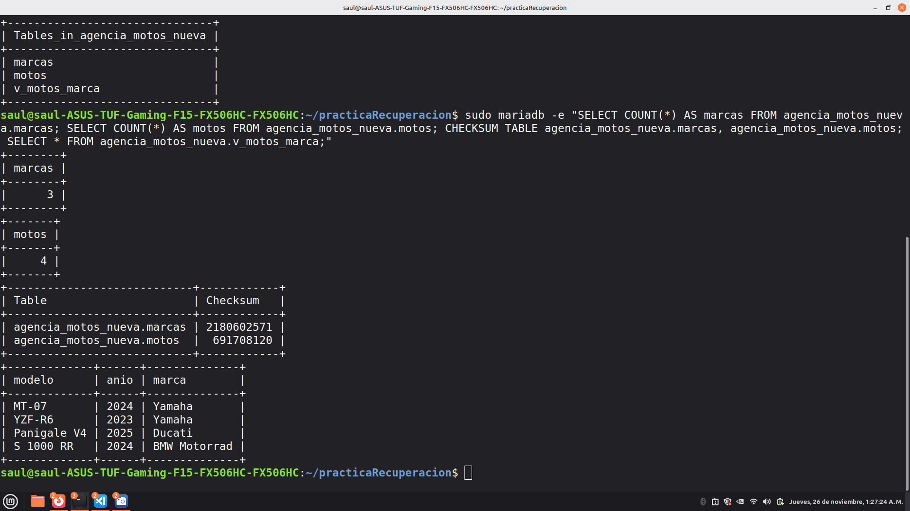
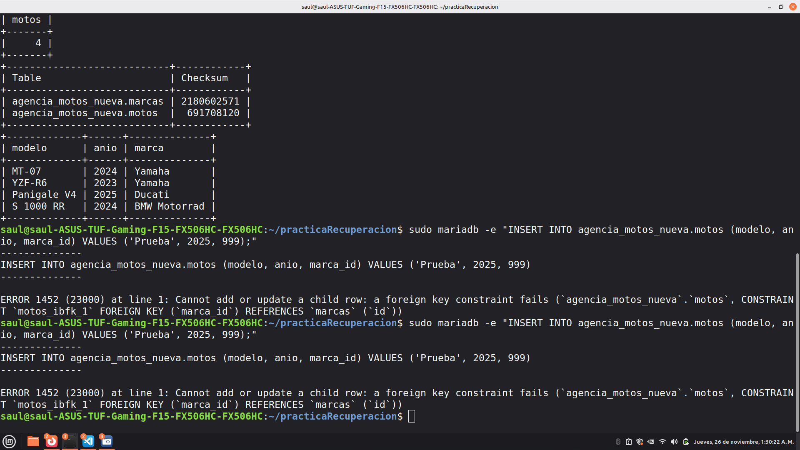
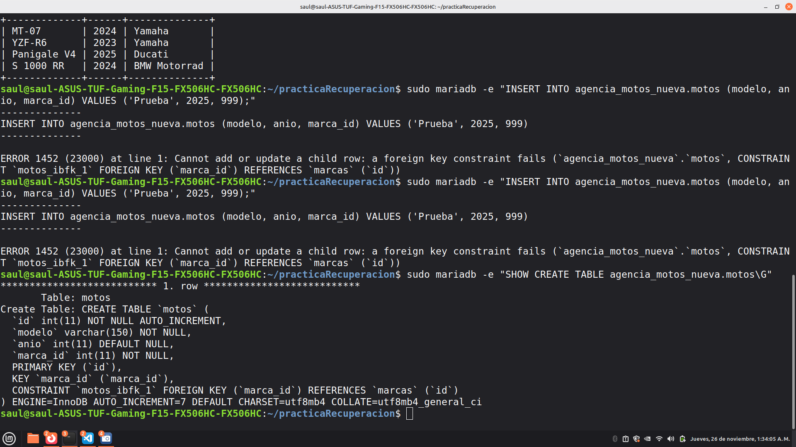

# Práctica: Migración de bases de datos en MariaDB

**Materia:** Administración de Bases de Datos  
**Alumno:** Saul Correa  
**Docente:** Diego Alberto Bollas Paredes  
**Fecha:** 26 de noviembre de 2026  

---

## Introducción

En esta práctica realicé la migración de la base de datos `agencia_motos` hacia una base nueva llamada `agencia_motos_nueva` dentro del mismo servidor de MariaDB desde la consola. El objetivo fue pasar la estructura de tablas, los datos, la llave foránea y la vista sin pérdida de información, y validar al final que los resultados coincidieran entre el origen y el destino.

---

## Desarrollo

### Paso 1. Crear la base de datos de origen

Creé la carpeta de trabajo, entré al cliente de MariaDB y generé la base `agencia_motos` con las tablas `marcas` y `motos`, sus registros iniciales y la vista `v_motos_marca`:

```bash
# Creo y entro a la carpeta de trabajo para mantener los archivos de la práctica ordenados
mkdir practicaRecuperacion && cd practicaRecuperacion
# Abro la consola de MariaDB con root solicitando contraseña
mariadb -u root -p
```

```sql
-- Creo la base de datos de origen para el escenario de la agencia de motos
CREATE DATABASE agencia_motos;
USE agencia_motos;

-- Tabla catálogo de marcas con clave primaria autoincremental
CREATE TABLE marcas (
    id INT AUTO_INCREMENT PRIMARY KEY,
    nombre VARCHAR(100) NOT NULL,
    pais VARCHAR(50)
);

-- Tabla de motos relacionada con marcas mediante llave foránea para mantener integridad referencial
CREATE TABLE motos (
    id INT AUTO_INCREMENT PRIMARY KEY,
    modelo VARCHAR(150) NOT NULL,
    anio INT,
    marca_id INT NOT NULL,
    FOREIGN KEY (marca_id) REFERENCES marcas(id)
);

-- Inserto los registros base de marcas
INSERT INTO marcas (nombre, pais) VALUES
('Yamaha', 'Japon'),
('Ducati', 'Italia'),
('BMW Motorrad', 'Alemania');

-- Inserto las motos referenciando los IDs existentes en marcas
INSERT INTO motos (modelo, anio, marca_id) VALUES
('MT-07', 2024, 1),
('YZF-R6', 2023, 1),
('Panigale V4', 2025, 2),
('S 1000 RR', 2024, 3);

-- Creo la vista para consultar modelo, año y nombre de marca mediante JOIN
CREATE VIEW v_motos_marca AS
SELECT m.modelo, m.anio, ma.nombre AS marca
FROM motos m
JOIN marcas ma ON ma.id = m.marca_id;

-- Consulto la vista para comprobar que devuelve los registros esperados
SELECT * FROM v_motos_marca;
EXIT;
```

**Resultado obtenido:** La vista mostró las 4 motos con su año y la marca correspondiente.



---

### Paso 2. Registrar los datos del origen (para comparar después)

Obtuve el conteo de registros y el valor de `CHECKSUM TABLE` de `marcas` y `motos` en la base original como referencia previa a la migración:

```bash
# Ejecuto las consultas en lote desde la terminal usando -e
mariadb -u root -p -e "
SELECT COUNT(*) AS marcas FROM agencia_motos.marcas;
SELECT COUNT(*) AS motos FROM agencia_motos.motos;
CHECKSUM TABLE agencia_motos.marcas, agencia_motos.motos;"
```

**Resultado obtenido:** Se obtuvieron 3 filas en `marcas` (Checksum: `2180602571`) y 4 filas en `motos` (Checksum: `691708120`).



---

### Paso 3. Hacer un respaldo de seguridad antes de migrar

Generé un respaldo previo con `--databases` para incluir las sentencias de creación y selección de base de datos, y verifiqué su creación con `ls -lh`:

```bash
# Respaldo completo previo con --databases por seguridad antes de modificar o migrar
mariadb-dump -u root -p --databases agencia_motos > respaldo_previo.sql
# Verifico que el archivo exista y tenga tamaño distinto de cero
ls -lh respaldo_previo.sql
```

**Resultado obtenido:** Se generó el archivo `respaldo_previo.sql` dentro de la carpeta de trabajo.



---

### Paso 4. Exportar la base de datos

Exporté la base de datos sin `--databases` para que el script `.sql` no fijara el nombre `agencia_motos` y pudiera importarse en una base con distinto nombre:

```bash
# Exporto sin --databases para poder cargarlo en agencia_motos_nueva; incluyo rutinas, triggers y eventos
mariadb-dump -u root -p --single-transaction --routines --triggers --events agencia_motos > agencia_motos_migracion.sql
```

**Resultado obtenido:** Se creó el archivo `agencia_motos_migracion.sql` sin errores.



---

### Paso 5. Crear la base de datos de destino

Creé la base de datos vacía `agencia_motos_nueva` en el servidor:

```bash
# Creo la base destino vacía antes de importar el volcado
mariadb -u root -p -e "CREATE DATABASE agencia_motos_nueva;"
```

**Resultado obtenido:** La base de datos `agencia_motos_nueva` quedó creada.



---

### Paso 6. Importar en el destino

Importé el archivo `agencia_motos_migracion.sql` dentro de `agencia_motos_nueva`:

```bash
# Cargo el archivo .sql sobre la base de datos destino
mariadb -u root -p agencia_motos_nueva < agencia_motos_migracion.sql
```

**Resultado obtenido:** La importación finalizó sin errores y se cargaron las tablas, los registros y la vista.



---

### Paso 7. Validar la migración

#### 7.1 Comparar conteos y checksum
```bash
# Verifico conteos y checksum en el destino para comprobar integridad de datos
mariadb -u root -p -e "
SELECT COUNT(*) AS marcas FROM agencia_motos_nueva.marcas;
SELECT COUNT(*) AS motos FROM agencia_motos_nueva.motos;
CHECKSUM TABLE agencia_motos_nueva.marcas, agencia_motos_nueva.motos;"
```

**Resultado obtenido:** Se obtuvieron 3 filas en `marcas` (Checksum: `2180602571`) y 4 filas en `motos` (Checksum: `691708120`), coincidiendo con el origen.




#### 7.2 Verificar que la vista funciona
```bash
# Pruebo que la vista migrada funcione correctamente en la nueva base
mariadb -u root -p -e "SELECT * FROM agencia_motos_nueva.v_motos_marca;"
```


#### 7.3 Verificar la integridad referencial
```bash
# Intento insertar un marca_id inexistente (999) para comprobar que la restricción FOREIGN KEY siga activa
mariadb -u root -p -e "INSERT INTO agencia_motos_nueva.motos (modelo, anio, marca_id) VALUES ('Prueba', 2025, 999);"
```

**Resultado obtenido:** MariaDB rechazó la inserción con `ERROR 1452`, confirmando que la restricción de clave foránea se conservó.



#### 7.4 Verificar la estructura
```bash
# Reviso la sentencia DDL de la tabla motos en formato vertical (\G)
mariadb -u root -p -e "SHOW CREATE TABLE agencia_motos_nueva.motos\G"
```

**Resultado obtenido:** Se mostró la estructura de la tabla `motos` con su llave primaria y su restricción `FOREIGN KEY`.



---

### Paso 8. Registrar el resultado

| Comprobación | Origen | Destino | ¿Coincide? |
|---|---|---|---|
| Filas en `marcas` | 3 | 3 | Sí |
| Filas en `motos` | 4 | 4 | Sí |
| Checksum `marcas` | `2180602571` | `2180602571` | Sí |
| Checksum `motos` | `691708120` | `691708120` | Sí |
| Vista `v_motos_marca` funciona | Sí | Sí | Sí |
| Clave foránea activa | Sí | Sí | Sí |

---

## Conclusiones

La práctica permitió migrar una base de datos de MariaDB desde la línea de comandos conservando la estructura, los datos, la vista y la integridad referencial. Usar `--databases` en el respaldo previo sirve como respaldo completo de la base original, mientras que omitirlo en la exportación permite reutilizar el `.sql` en una base con otro nombre. Finalmente, comparar `COUNT(*)` y `CHECKSUM TABLE` junto con pruebas de restricción resulta práctico para verificar que la migración no alteró ni perdió información.